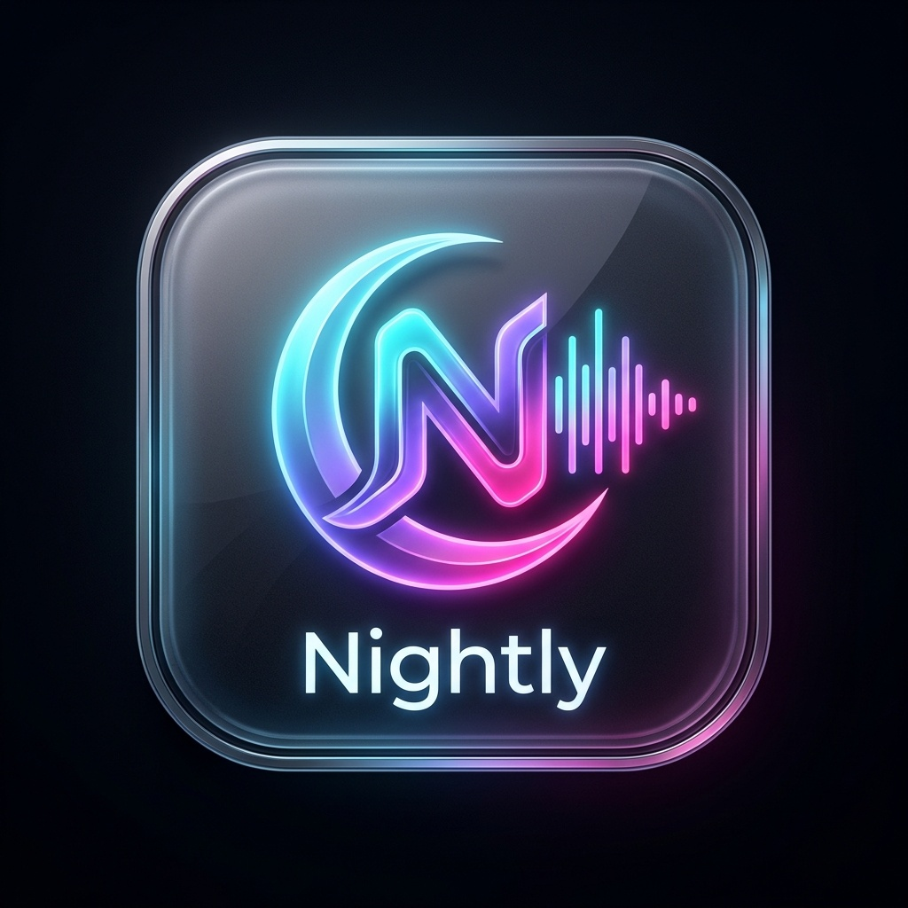

<div align="center">



# Nightly — Multiplatform Music Player


<p align="center">
  <b>A flagship, high-performance, extension-based music player built for Windows Desktop and Android.</b><br>
  Powered by Kotlin Multiplatform, Compose Multiplatform, SQLDelight, LibVLC, Skia GPU rendering, and native Windows WASAPI Loopback DSP.
</p>

</div>

---

## ⚡ Latest Release — v1.0.4

| Platform | Format | File | Size | Download |
| :--- | :--- | :--- | :--- | :--- |
| 🛡️ **Windows** (x64) | **Trusted Setup ZIP** *(Recommended)* | `Nightly-v1.0.4-Windows-Trusted-Setup.zip` | 396.9 MB | [⬇️ **Download Trusted Setup**](https://github.com/aaweshdas/Audix-Multiplatform-Music-Player/releases/latest/download/Nightly-v1.0.4-Windows-Trusted-Setup.zip) \| [Release Notes](https://github.com/aaweshdas/Audix-Multiplatform-Music-Player/releases/tag/v1.0.4) |
| 💻 **Windows** (x64) | **EXE Setup** *(Signed)* | `Nightly-v1.0.4-Windows-Installer.exe` | 398.8 MB | [⬇️ **Download EXE**](https://github.com/aaweshdas/Audix-Multiplatform-Music-Player/releases/latest/download/Nightly-v1.0.4-Windows-Installer.exe) \| [Release Notes](https://github.com/aaweshdas/Audix-Multiplatform-Music-Player/releases/tag/v1.0.4) |
| 💻 **Windows** (x64) | **MSI Installer** *(Signed)* | `Nightly-v1.0.4-Windows-Installer.msi` | 398.1 MB | [⬇️ **Download MSI**](https://github.com/aaweshdas/Audix-Multiplatform-Music-Player/releases/latest/download/Nightly-v1.0.4-Windows-Installer.msi) \| [Release Notes](https://github.com/aaweshdas/Audix-Multiplatform-Music-Player/releases/tag/v1.0.4) |
| 📦 **Windows** (x64) | **Portable ZIP** *(No Install)* | `Nightly-v1.0.4-Windows-Portable.zip` | 411.3 MB | [⬇️ **Download Portable**](https://github.com/aaweshdas/Audix-Multiplatform-Music-Player/releases/latest/download/Nightly-v1.0.4-Windows-Portable.zip) \| [Release Notes](https://github.com/aaweshdas/Audix-Multiplatform-Music-Player/releases/tag/v1.0.4) |
| 📱 **Android** (SDK 24+) | **APK** | `Nightly-v1.0.4-Android.apk` | 14.9 MB | [⬇️ **Download APK**](https://github.com/aaweshdas/Audix-Multiplatform-Music-Player/releases/latest/download/Nightly-v1.0.4-Android.apk) \| [Release Notes](https://github.com/aaweshdas/Audix-Multiplatform-Music-Player/releases/tag/v1.0.4) |

> [!TIP]
> **Windows Quick Setup:** Download `Nightly-v1.0.4-Windows-Trusted-Setup.zip`, extract it, and run **`Install-Nightly-Trusted.bat`** as administrator for verified publisher trust with zero SmartScreen prompts.

---

### ✨ What's New in v1.0.4

- 💓 **Real-Time Music-Vibration ECG Heartbeat Visualizer**:
  - **Native Windows WASAPI Loopback Audio Tap** via JNA COM (`AUDCLNT_STREAMFLAGS_LOOPBACK`) — zero interference with LibVLC's native output, equalizer, volume, or headphone/Bluetooth device switches.
  - **1024-Point FFT + Adaptive AGC + Dual-Band Spectral-Flux Beat Detector**: Locks onto real kick drums, bass drops, and snare hits at any volume (15%–100%), while live 96-sample PCM vibration ripples directly through the crimson laser beam.
  - **GPU Skia Gaussian Neon Bloom & Zero-GC Engine**: Hardware-accelerated `MaskFilter.makeBlur`, seamless elliptical radial crimson aura, razor-sharp needle apexes, waveform-locked telemetry spark, and 0 Compose recompositions/sec (~1.3%–2.6% normalized CPU).
- 🎤 **Synchronized Karaoke Lyrics Studio**: Built-in LRCLIB-powered scrolling lyrics modal directly accessible from the Soundstage Billboard header (`LYRICS`), complete with active-line glow highlight and click-to-seek timestamp navigation.
- ⏱️ **Nightly Sleep Timer**: Configurable presets (15m / 30m / 45m / 60m), live countdown, optional auto-exit, and a smooth 30-second exponential audio fade-out ramp before pausing.
- 🎬 **In-App Direct3D Cinema Theater & Movie Play**: Unified 2-row Movie Play command dock and integrated Direct3D video theater.
- 🎨 **Complete Nightly Brand & Media Accuracy**: Unified **Nightly v1.0.4** identity, high-resolution artwork & metadata resolution across all 10 bundled extensions, and Authenticode-signed Windows `.exe` / `.msi` installers with RFC3161 timestamps.

---

### 📥 How to Install & Configure Extensions
1. **Install Nightly**: Run **`Nightly-v1.0.4-Windows-Installer.exe`** (or extract the Portable ZIP) on Windows, or install **`Nightly-v1.0.4-Android.apk`** on Android.
2. **Pre-Bundled Desktop Extensions**: All 10 flagship desktop extensions (YouTube Music, JioSaavn, SoundCloud, Spotify, Radio Browser, LRCLIB, Musixmatch, Genius, Discord RPC, Last.fm) are automatically bundled and synchronized on launch.
3. **Adding Community Extensions (Android / Custom)**:
   - Open **Extensions** -> tap **Add (`+`)** -> paste:
     ```
     https://raw.githubusercontent.com/itsmechinmoy/echo-extensions/main/echo_extensions.json
     ```

---

## 📖 Overview

**Nightly** is an extensible, privacy-conscious audio player. Rather than hardcoding closed streaming services, Nightly uses a decoupled **Extension SPI Architecture** that dynamically loads audio sources, metadata providers, synchronized lyrics engines, and social integrations at runtime.

The desktop client (**Nightly Desktop**) delivers a studio-grade interface featuring Direct3D hardware acceleration, liquid-glass design, real-time WASAPI audio telemetry, synchronized lyrics, AI Studio, system tray integration, and global Windows media key support.

> [!NOTE]
> Nightly is designed as an offline player and extension host. The application itself hosts zero content and does not condone piracy. Users configure their own extensions and manage their own local libraries.

---

## 🏗️ Architecture & Modules

```text
┌─────────────────────────────────────────────────────────────────┐
│                       Nightly Workspace                         │
├─────────────────┬─────────────────┬──────────────┬──────────────┤
│      :app       │   :desktopApp   │    :core     │   :common    │
│  (Android App)  │(Compose Desktop)│(DB & Engine) │ (Domain SPI) │
└─────────────────┴─────────────────┴──────────────┴──────────────┘
```

| Module | Target | Description |
| :--- | :--- | :--- |
| [**:app**](./app) | Android (SDK 24–36) | Android application with Material 3 UI, background playback services, home widgets, and Media3 ExoPlayer. |
| [**:desktopApp**](./desktopApp) | JVM / Desktop | Compose Multiplatform desktop client (**Nightly Desktop**) with Decompose navigation, Koin DI, Skia GPU visualizers, Cinema Theater, Lyrics Studio, Sleep Timer, and Windows tray/media keys. |
| [**:core**](./core) | Common & JVM | Shared business logic, SQLDelight database (`EchoDatabase`), LibVLC playback engine, Windows WASAPI Loopback DSP (`AudioVisualizerManager`), and dynamic JAR extension loader. |
| [**:common**](./common) | Kotlin Multiplatform | Core domain models (`Track`, `Album`, `Artist`, `Playlist`), client interfaces, centralized `FlavorConfig`, and Extension SPI. |

---

## 📂 Repository Structure

```text
echo-nightly/
├── .github/                              # GitHub Actions workflows & issue templates
├── .gitignore                            # Build, cache, and artifact ignore rules
├── AI_POLICY.md                          # Project AI & contribution policy
├── LICENSE.md                            # GNU General Public License v3.0
├── README.md                             # Project documentation & release links
├── SUMMARY.md                            # Engineering & security resolution summary
├── NIGHTLY_COMPLETE_APPLICATION_SPECIFICATION.txt
├── Run-Nightly.bat                       # Primary Windows desktop launcher
├── Trust-Nightly-Certificate.bat         # Windows trusted root certificate helper
├── Nightly-CodeSigning-CA.cer            # Public Nightly code-signing CA certificate
│
├── app/                                  # [Module] Android Application (Media3 ExoPlayer)
├── common/                               # [Module] KMP Domain Models & Extension SPI
├── core/                                 # [Module] LibVLC Engine, WASAPI DSP & SQLDelight
├── desktopApp/                           # [Module] Nightly Compose Desktop UI & ViewModels
├── extensions/                           # [Modules] Source code for bundled extensions
├── gradle/                               # Gradle wrapper & unified libs.versions.toml
├── scripts/                              # Build, inject, sign, verify & release toolchain
│   ├── README.md                         # Toolchain documentation
│   ├── compile_desktop_app.py            # Embedded Kotlin/Compose compiler pipeline
│   ├── inject_classes_and_assets.py      # Bytecode, asset & extension JAR injector
│   ├── build_windows_installers.py       # jpackage + WiX MSI/EXE & bundle packager
│   ├── sign_all_release_binaries.py      # SHA-256 Authenticode signer & verifier
│   ├── publish_github_release.py         # GitHub Releases API publisher with SHA-256
│   ├── launch_and_verify.py              # Process health & launch verifier
│   └── archive/                          # Historical migration scripts
└── tools/                                # Brand artwork, manifests & recovered references
```

---

## 🧩 Bundled Extension Ecosystem

| Extension | Category | Capability |
| :--- | :--- | :--- |
| **YouTube Music** (`youtube.jar`) | Audio Streaming | Search, browse charts, and stream audio with adaptive bitrates. |
| **JioSaavn** (`saavn.jar`) | Audio Streaming | High-bitrate Bollywood, regional, and international catalog streaming. |
| **SoundCloud** (`soundcloud.jar`) | Audio Streaming | Independent tracks, mixes, and curated playlists. |
| **Spotify** (`spotify.jar`) | Catalog & Charts | Popular charts, curated catalogs, and metadata integration. |
| **Radio Browser** (`radiobrowser.jar`) | Live Radio | Global directory of thousands of live internet radio stations. |
| **LRCLIB** (`lrclib.jar`) | Synchronized Lyrics | Time-synced karaoke scrolling lyrics database. |
| **Musixmatch** (`musixmatch.jar`) | Lyrics Provider | Comprehensive lyrics search and rich text lyrics. |
| **Genius** (`genius.jar`) | Lyrics & Annotations | Song lyrics, background stories, and annotations. |
| **Discord RPC** (`discordrpc.jar`) | Social Integration | Live Discord Rich Presence with track title, artist, and status. |
| **Last.fm** (`lastfm.jar`) | Scrobbling | Automatic playback scrobbling and listening history sync. |

Desktop extensions are synchronized automatically to `%APPDATA%\Echo\extensions\`.

---

## 🚀 Building & Running Locally

### Prerequisites
- **JDK 21** (OpenJDK 21 LTS recommended)
- **Python 3.10+** (for desktop compilation, packaging, and signing automation)
- **Android SDK** (API 36 / minSdk 24) for Android builds

### Quick Launch (Windows)
```cmd
.\Run-Nightly.bat
```

### Compile, Package & Sign Desktop (Windows)
```powershell
python scripts/compile_desktop_app.py
python scripts/inject_classes_and_assets.py
python scripts/build_windows_installers.py
```

### Build Android APK
```powershell
.\gradlew.bat :app:assembleNightly
```

---

## 📜 Community & Support

- **GitHub Releases**: [Latest Releases](https://github.com/aaweshdas/Audix-Multiplatform-Music-Player/releases)
- **Discord**: [Join Official Server](https://discord.gg/J3WvbBUU8Z)

---

## ⚖️ License

Nightly is free software licensed under the **GNU General Public License v3.0** (GPL-3.0). See [LICENSE.md](./LICENSE.md) for full details.
